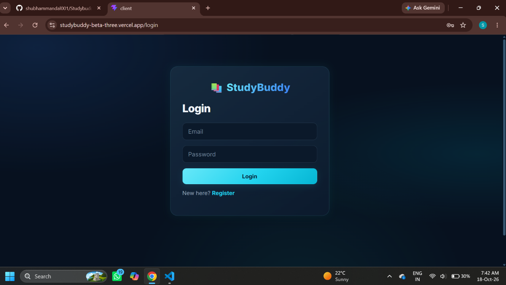
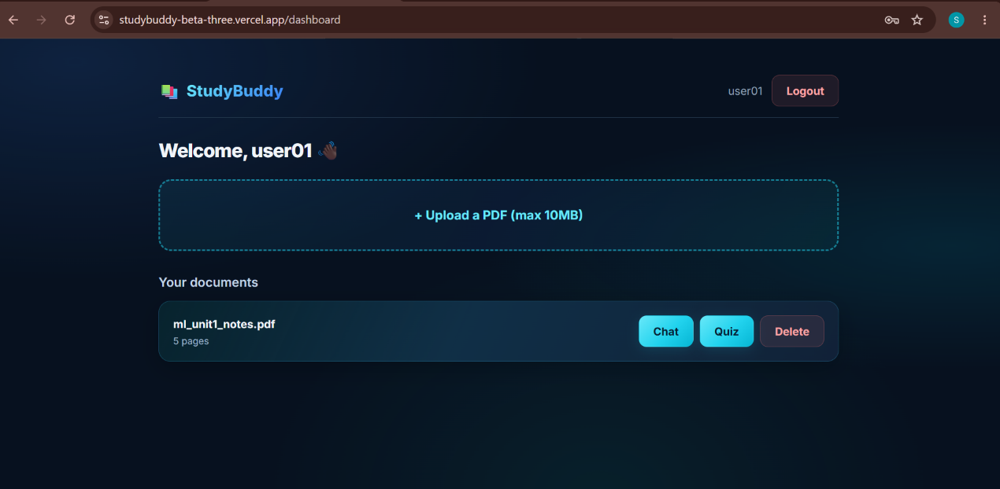
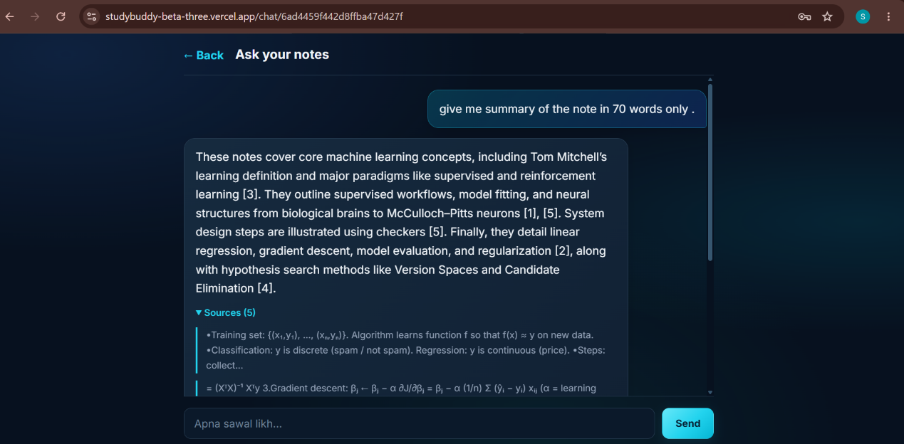
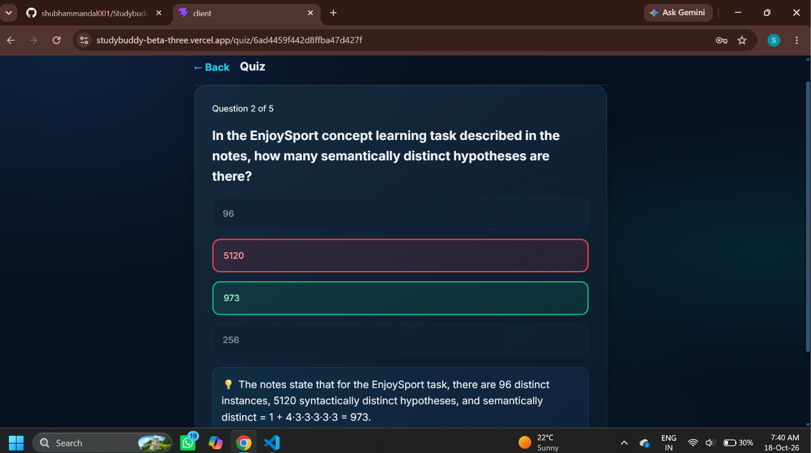
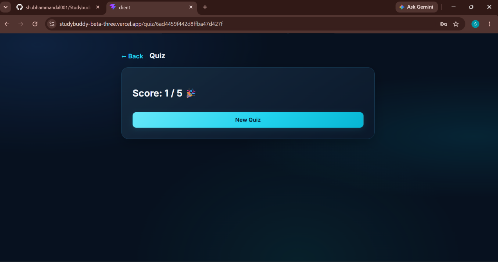
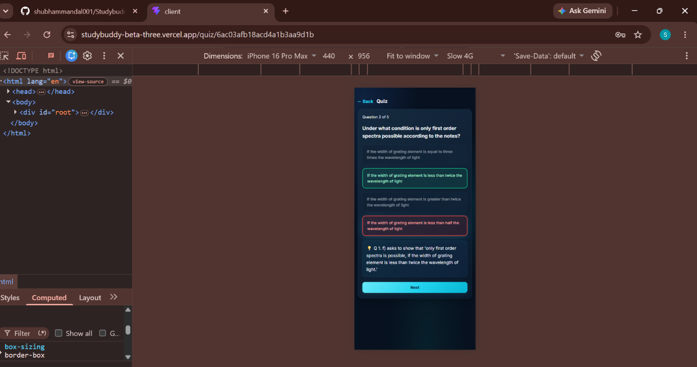
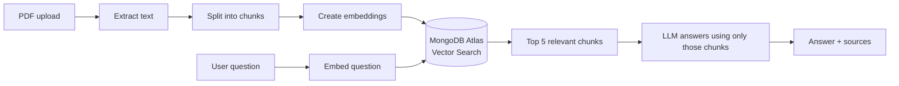

# 📚 StudyBuddy

**AI-powered study assistant.**
 Upload your notes as a PDF, ask questions and get answers grounded in your own material (with sources), and generate quizzes to test yourself.
 Built with the MERN stack and Retrieval-Augmented Generation (RAG).

🔗 **Live demo:** [studybuddy-beta-three.vercel.app](https://studybuddy-beta-three.vercel.app)

> The backend runs on a free Render instance, so the first request after a period of inactivity can take 30–60 seconds to wake up.

---

## Screenshots

| Login | Dashboard |
|---|---|
|  |  |

| Chat with sources | Quiz |
|---|---|
|  |  |

| Quiz score | Mobile |
|---|---|
|  |  |

---

## Features

- 🔐 **Authentication:** register/login with JWT, passwords hashed with bcrypt, protected routes on both frontend and backend
- 📄 **PDF upload:** text is extracted from the PDF and stored per user (10 MB limit)
- 💬 **Chat with your notes:** ask a question and get an answer based only on your document, with the source passages shown
- 📝 **Quiz generator:** auto-generates 5–10 multiple-choice questions with explanations, instant right/wrong feedback and a final score
- 👤 **Private by design:** every user can only see, query and delete their own documents
- 📱 **Responsive dark UI** that works on desktop and mobile

---

## How it works (RAG pipeline)



1. **Ingest:** the PDF text is split into ~1000-character chunks with 200 characters of overlap, so sentences cut at a boundary still keep their meaning.
2. **Embed:** each chunk is converted into a 768-dimension vector using Gemini embeddings and stored in MongoDB Atlas.
3. **Retrieve:** a question is embedded the same way, and Atlas Vector Search (cosine similarity, filtered by user and document) returns the 5 closest chunks.
4. **Generate:** the chunks are passed to a Gemini model with a strict prompt: answer only from the notes, say so if the answer isn't there. The notes are treated as data, not instructions.
5. **Quiz:** chunks spread evenly across the document are sent to the model, which returns JSON questions. The server validates the format before sending it to the client.

---

## Tech stack

| Layer | Tools |
|---|---|
| Frontend | React (Vite), React Router, Axios |
| Backend | Node.js, Express |
| Database | MongoDB Atlas (Mongoose), Atlas Vector Search |
| AI | Google Gemini API (embeddings + text generation) |
| Auth | JWT, bcryptjs |
| File handling | Multer (memory storage), pdf-parse |
| Hosting | Vercel (frontend), Render (backend), all on free tiers |

---

## API endpoints

All routes except register and login require an `Authorization: Bearer <token>` header.

| Method | Endpoint | Description |
|---|---|---|
| POST | `/api/auth/register` | Create an account |
| POST | `/api/auth/login` | Log in and receive a token |
| GET | `/api/auth/me` | Get the current user |
| POST | `/api/documents` | Upload a PDF (multipart, field name `file`) |
| GET | `/api/documents` | List your documents |
| DELETE | `/api/documents/:id` | Delete a document and its chunks |
| POST | `/api/chat` | Ask a question about a document |
| POST | `/api/quiz` | Generate a quiz for a document |

---

## Project structure

```
studybuddy/
├── client/                  # React frontend (Vite)
│   └── src/
│       ├── components/      # Navbar, ProtectedRoute
│       ├── context/         # AuthContext
│       ├── pages/           # Login, Register, Dashboard, Chat, Quiz
│       └── api.js           # Axios instance with token interceptor
└── server/                  # Express backend
    ├── controllers/         # auth, document, chat, quiz logic
    ├── middleware/          # JWT protect, multer upload
    ├── models/              # User, Document, Chunk
    ├── routes/
    └── utils/               # chunker, embeddings, retrieval, generation
```

---

## Run locally

**Prerequisites:** Node.js 18+, a free MongoDB Atlas cluster, and a Gemini API key from Google AI Studio.

```bash
git clone https://github.com/shubhammandal001/studybuddy.git
cd studybuddy
```

**Backend**

```bash
cd server
npm install
```

Create `server/.env`:

```
PORT=5000
MONGO_URI=your_mongodb_atlas_connection_string
JWT_SECRET=any_long_random_string
GEMINI_API_KEY=your_gemini_api_key
GEMINI_MODEL=a_gemini_flash_model_name
GEMINI_FALLBACK_MODEL=a_second_model_name
```

In Atlas, create a **Vector Search index** named `vector_index` on the `studybuddy.chunks` collection:

```json
{
  "fields": [
    { "type": "vector", "path": "embedding", "numDimensions": 768, "similarity": "cosine" },
    { "type": "filter", "path": "user" },
    { "type": "filter", "path": "document" }
  ]
}
```

```bash
npm run dev
```

**Frontend**

```bash
cd client
npm install
```

Create `client/.env`:

```
VITE_API_URL=http://localhost:5000/api
```

```bash
npm run dev
```

Open `http://localhost:5173`.

---

## Deployment

- **Backend:** Render web service, root directory `server`, build `npm install`, start `npm start`, environment variables set in the Render dashboard.
- **Frontend:** Vercel, root directory `client`, with `VITE_API_URL` pointing to the Render backend (`https://<your-service>.onrender.com/api`). `vercel.json` rewrites all routes to `index.html` so React Router works on refresh.

---

## Known limitations

- Scanned PDFs (images without selectable text) are not supported, since there is no OCR step.
- Very large PDFs are rejected (10 MB / ~150 chunks) to stay within free-tier limits.
- The free Render instance sleeps when idle, so the first request can be slow.
- AI-generated answers and quizzes can occasionally be wrong; sources are shown so answers can be verified.

## Ideas for the future

- OCR support for scanned notes
- Chat with multiple documents at once
- Flashcards and saved quiz history
- Streaming responses

---

## Author

**Shubham Mandal**
B.Tech CSE, Faculty of Technology, Uttarakhand Technical University
GitHub: [@shubhammandal001](https://github.com/shubhammandal001)
